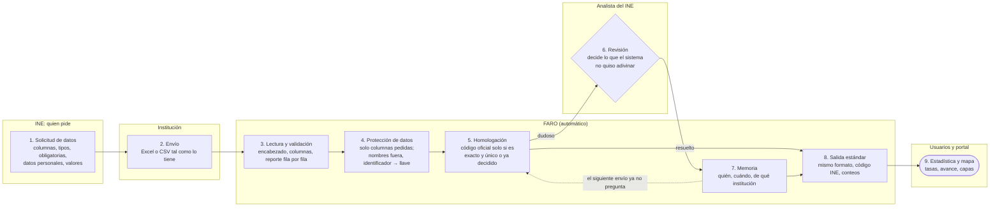
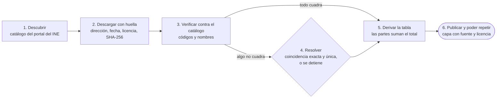
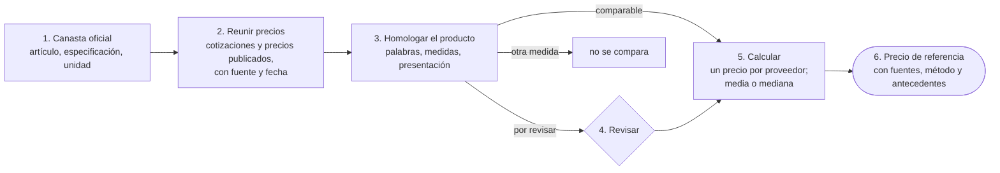

# Flujo de proceso

Qué pasa en cada etapa y quién la hace. La pantalla lo muestra en vivo, con las cifras de cada
etapa, en la sección "Proceso". Las etapas marcadas como decisión las toma siempre una persona.

## Registros administrativos: de la solicitud a la estadística

| Etapa | Entrada | Qué hace | Salida | Dónde está |
|---|---|---|---|---|
| 1. Solicitud | Necesidad del INE | Declara columnas, tipos, obligatorias, pareo, dato personal, valores, "sin dato", respaldo | Archivo de solicitud | `datos/solicitudes/*.toml` |
| 2. Envío | Archivo de la institución | Se sube sin reformatear | Archivo en un temporal | Pantalla "Recibir envío" |
| 3. Lectura y validación | Archivo | Ubica encabezado, reconoce alias, valida tipo y contenido | Reporte de problemas | `lectura.rs`, `solicitud.rs` |
| 4. Protección de datos | Filas | Elimina columnas no pedidas y nombres; sustituye identificadores por llave | Filas sin datos personales | `recepcion.rs` |
| 5. Homologación | Textos de lugar y valores | Exacto y único, o memoria; si no, propone | Código o pendiente | `homologar.rs`, `productos.rs` |
| 6. Revisión | Pendientes | Una persona elige | Decisión | Pantalla "Revisar pendientes" |
| 7. Memoria | Decisión | La guarda con autor y fecha | Equivalencia | Base de datos |
| 8. Salida estándar | Filas homologadas | Formato único y conteos por periodo, municipio y sexo | CSV privado y conteos | Volumen privado, base de datos |
| 9. Estadística y mapa | Conteos y población | Tasas, avance, mapa, capas | Capas publicadas | Pantalla y `/capas` |

## Fuentes abiertas: del portal a la capa publicada

Así se procesaron las proyecciones de población (16 códigos de municipio reubicados), los límites
municipales (dos códigos intercambiados) y la red vial. El caso de población se puede repetir
desde la pantalla ("Población y crecimiento" → "Repetir el proceso ahora") o con `faro poblacion`.

## Precios: de la canasta oficial al precio de referencia

