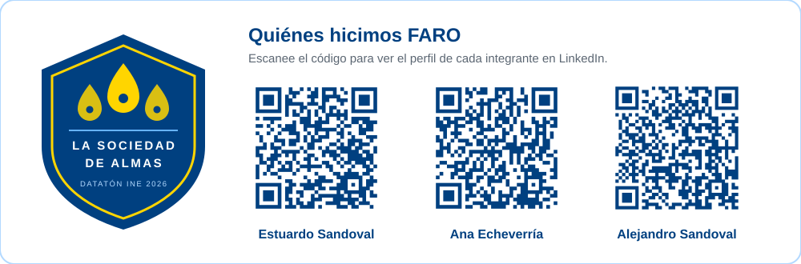

# Preguntas probables del jurado y cómo responderlas

*FARO · Que cada dato llegue a puerto.* Equipo La Sociedad de Almas. Preparado el 25-nov-2026 para
la final del Datatón INE 2026 (7 minutos de exposición y **3 minutos de preguntas**).

Este documento es para ensayar. Reúne las preguntas que un jurado del INE puede hacer, ordenadas
por el criterio de evaluación al que apuntan, con una respuesta que cabe en 20 o 30 segundos. Las
preguntas más difíciles llevan además la **pregunta de seguimiento** que suele venir después y su
respuesta. Todo lo que aquí se afirma está en el repositorio; al final de cada respuesta se dice
dónde.

## Cómo usar los tres minutos

- **Responder primero, explicar después.** La primera frase es la respuesta («Sí», «No», «Todavía
  no»); la segunda, la prueba; la tercera, dónde verla. Si el jurado quiere más, lo pide.
- **Una persona responde cada pregunta.** Repartir antes: quien presentó responde lo institucional;
  quien manejó el portal, lo técnico; el tercero, datos, ley y seguridad.
- **Si no se sabe, decirlo.** «Eso no lo medimos» o «eso lo debe decidir el INE» es mejor respuesta
  que improvisar una cifra. El proyecto entero se apoya en no inventar: la respuesta tampoco.
- **No discutir con el jurado.** Si señalan una debilidad cierta, reconocerla y decir qué se haría:
  casi todas ya están escritas en las limitaciones del README.
- **Tener abiertos** el portal, la diapositiva 15 (cumplimiento) y la 16 (lo que no hace).

**Cuatro frases que hay que cuidar.**

| No decir | Decir |
|---|---|
| «No usamos inteligencia artificial» | «El portal no depende de una IA externa para funcionar. Programamos con un asistente de IA, y está declarado» |
| «El portal está traducido al kaqchikel» | «Tiene un borrador de 680 rótulos en kaqchikel, con fuentes, sin revisar, a completar con asesoría experta» |
| «Cumple con la ley» | «Hicimos un análisis norma por norma; no es un dictamen: lo debe revisar la asesoría jurídica del INE» |
| «Las proyecciones son exactas» | «Medimos su error: 8 de cada 10 veces, 20 % o menos a diez años. Ese margen es el que se muestra» |

## 1. Funcionalidad (25 %)

### 1.1 ¿Qué hace exactamente FARO, en una frase?

Hace que el INE reciba de cualquier institución datos que puede usar el mismo día: define qué se
pide, comprueba lo que llega, pone el código oficial a cada lugar sin adivinar, quita los datos
personales y deja constancia de cada paso. Sobre eso, aprovecha lo recibido junto al censo, el
territorio y los precios. *(README, «Qué hace».)*

### 1.2 ¿Funciona con datos reales o solo con ejemplos?

Con datos reales. Pasamos los archivos que el INE compartió, tal como salen de cada sistema y sin
modificarlos: más de 50 mil registros de RENAP, PNC y SE-CONRED. Los lugares quedaron con código
oficial en 100 % de RENAP y PNC y en 99.9 % de SE-CONRED; cada archivo tarda menos de dos
segundos. En los documentos solo hay conteos. *(`docs/06`.)*

**Seguimiento: ¿y el 0.1 % que no quedó?** Son cinco registros con nombres mal escritos o de otro
departamento. El sistema no los adivina: los deja como pendientes, propone candidatos y una
persona decide una vez. Esa decisión queda guardada y ya no se vuelve a preguntar.

**Seguimiento: ¿por qué en el video no se ven esos archivos?** Sí se ve el proceso, pero en
pantalla solo aparecen conteos y nombres de lugares: los archivos traen CUI, nombres y
direcciones, y eso no se muestra ni se guarda.

### 1.3 ¿Qué pasa si la demostración falla aquí mismo?

Hay tres respaldos: el video de 2:55 grabado del portal, las capturas de cada sección en la
presentación y el manual gráfico. Además el portal corre en la propia computadora, sin depender
de internet para lo esencial.

### 1.4 ¿Qué tan terminado está? ¿Es un prototipo o un producto?

Es un prototipo funcional completo: 24 secciones en uso, cuentas con cinco roles, bitácora,
manual, instalación con un comando probada desde un clon limpio, 96 pruebas automáticas y 21
recorridos de pantalla. Para ser producto le falta lo que escribimos como pendiente: publicarlo
con HTTPS, pruebas en Windows, y tres mejoras de seguridad de baja prioridad. *(`docs/21`,
`docs/26` sección 7.)*

### 1.5 ¿Qué no hace todavía?

Cuatro cosas, dichas en el README: los históricos de Guatecompras (el sitio bloquea clientes
automáticos y no lo evadimos), la comparación con los censos de 2002 y 1994 por municipio (no hay
fuente descargable), el Índice de Costos de la Construcción y el catálogo del Manual de
Características del IPC (no es público). *(README, «Limitaciones»; diapositiva 16.)*

### 1.6 ¿Qué pasa si una institución manda el archivo mal: columnas de más, de menos o con otro nombre?

La solicitud declara qué columnas se piden y con qué nombres pueden venir. Las columnas que no se
piden no pasan (en defunciones de RENAP llegan 82 y pasan 15). Si falta una columna obligatoria,
el envío se rechaza con el motivo. Si un valor no está en el catálogo, queda como pendiente y no
se cuenta hasta que alguien decida.

### 1.7 ¿Qué pasa si la institución manda dos veces el mismo mes?

No se cuenta dos veces. Cada envío se parte por su mes de registro (el «corte»); un envío nuevo
del mismo corte reemplaza al anterior en las estadísticas y el anterior queda en el historial
como reemplazado. *(vista `envios_vigentes`; `docs/28`.)*

## 2. Aplicabilidad institucional (20 %, y desempata)

### 2.1 ¿Qué necesidad real del INE resuelve?

Las que el propio INE planteó en el lanzamiento: que cada institución envía a su manera, que los
registros traen datos personales que no deben viajar, que no hay seguimiento de quién ya envió, y
las propuestas de las direcciones (territorio, trabajo de campo, precios, tableros). El estado de
cada una, incluido lo que no se hizo, está en una tabla. *(`docs/01`.)*

**Seguimiento: son muchas cosas. ¿No habría sido mejor hacer una sola bien?** El núcleo es uno:
recibir y homologar registros. Lo demás usa ese mismo núcleo y el mismo catálogo de lugares: por
eso no son cinco herramientas, sino una. Y cada parte está probada y documentada por separado;
si el INE solo quiere el núcleo, las demás secciones se ocultan por grupo, sin tocar código.

### 2.2 ¿Qué necesita el INE para adoptarlo?

Tres cosas: un servidor con Docker, escribir sus solicitudes (un archivo por registro que pide) y
crear sus usuarios. No hay licencias que comprar. Nuestra petición es concreta: un piloto de un
mes, con una institución, en un servidor del INE.

**Seguimiento: ¿cuánto cuesta mantenerlo?** En licencias, cero. El costo es el servidor y el
tiempo de una persona que administre usuarios y solicitudes. No hay pago por consulta ni por
usuario.

**Seguimiento: ¿y quién lo mantiene si ustedes ya no están?** El código queda en el repositorio
con licencia perpetua para el INE, con 31 documentos, una guía que dice en qué archivo está cada
regla y pruebas automáticas que avisan si un cambio rompe algo. Lo que más cambia (instituciones,
tiendas, umbrales, idiomas) son archivos de configuración, no código. *(`docs/28`; `LICENCIA.md`.)*

**Seguimiento: el INE no tiene programadores de Rust.** Es cierto que Rust es menos común. Por eso
lo que el INE tocará a diario no es Rust: son archivos de texto y la pantalla. Para cambiar una
regla del núcleo sí hace falta alguien que programe; a cambio, el servidor es un solo ejecutable,
sin dependencias que instalar ni versiones que se desactualicen por su cuenta.

### 2.3 ¿Cómo se relaciona con X-Road o con la interoperabilidad del Estado?

Se complementan. X-Road es la carretera: transporta mensajes entre instituciones con identidad y
cifrado. FARO es el formulario de aduana: dice qué se pide y comprueba lo que llega. Una solicitud
de FARO puede publicarse mañana como un servicio sobre X-Road sin cambiar el contrato de datos.
*(`docs/03`.)*

### 2.4 ¿Qué tan difícil es sumar una institución nueva?

Es escribir un archivo de solicitud: qué columnas, de qué tipo, contra qué catálogo y cuáles son
dato personal. Hoy hay cuatro instituciones; la quinta no pide programar. La pantalla genera
además la plantilla que la institución llena.

**Seguimiento: ¿y si esa institución usa códigos propios, no los del INE?** Fue justo lo que pasó
con RENAP: parte el código en dos columnas y solo vale cuando el país es Guatemala. Se resolvió
declarándolo en la solicitud, no programando un caso especial. Y si usa un catálogo distinto, se
carga una tabla de equivalencias una vez.

### 2.5 ¿Las instituciones van a querer usarlo? ¿Qué ganan ellas?

Ganan tres cosas: saben exactamente qué se les pide (una plantilla, no un oficio), reciben al
instante el resultado de su envío con lo que hay que corregir, y dejan de enviar datos personales
que no hacen falta, lo que reduce su propio riesgo. Cada institución entra con su cuenta y solo
ve lo suyo.

### 2.6 ¿Aguanta el volumen real? ¿Y si son millones de registros?

Lo medido: 30 mil registros en 1.7 segundos en una laptop. A la base no llegan las filas, llegan
los conteos, así que la base no crece con cada persona registrada. No lo hemos probado con
millones de filas en un solo archivo: eso lo diría el piloto.

### 2.7 ¿Funciona sin internet? ¿Y en las delegaciones?

Sí: el portal trae sus datos y funciona en una red interna. Internet solo hace falta para lo
opcional: el mapa de fondo, las fotos satelitales, sincronizar con el portal del INE y leer
precios de tiendas. Y se usa desde un teléfono: se probó en seis tamaños de pantalla.

## 3. Calidad técnica (20 %)

### 3.1 ¿Por qué Rust y no Python o R, que son lo que usa la estadística?

Por lo que deja instalado: un solo ejecutable, sin dependencias en la máquina del INE, seguro en
memoria y rápido. El mismo código sirve al portal y a la línea de comandos. Quien analiza puede
seguir usando R o Python: todo lo que FARO produce se descarga en CSV y GeoJSON.

### 3.2 ¿Cómo sabemos que el código funciona y no solo «parece» funcionar?

Por cuatro comprobaciones que cualquiera puede repetir: 96 pruebas automáticas de las reglas; 21
recorridos de la pantalla en un navegador real, con clic real en el mapa y teléfono simulado; una
verificación estadística contra lo ocurrido; y la instalación desde un clon limpio. *(`docs/19`,
`docs/20`, `docs/28` sección 4.)*

### 3.3 ¿El jurado puede instalarlo? ¿Cuánto tarda?

Cuatro pasos: clonar, copiar `.env`, poner tres claves y `docker compose up -d --build`. La
primera vez tarda varios minutos porque compila; después arranca en segundos. Lo probamos desde
un clon limpio el 25 de noviembre.

**Seguimiento: ¿y en Windows?** Hay un `iniciar.bat` que hace los pasos por usted, pero no lo
pudimos probar en Windows desde nuestro entorno de trabajo y así lo dice el README. Con Docker
Desktop, los cuatro pasos son los mismos.

### 3.4 ¿Cómo está organizado el código?

Cinco piezas: el núcleo de homologación, el territorio (vías, crecimiento, precios), las fuentes
(descargas con procedencia, muestreos, fotos), el servidor con la pantalla y la línea de comandos.
Cada tabla derivada tiene un comando que la regenera. *(`docs/03`; `docs/28` sección 1.)*

### 3.5 ¿Por qué la pantalla es una sola página sin React ni otro marco?

Para no tener nada que compilar ni mantener del lado del navegador: va dentro del ejecutable y
funciona sin internet. El costo es un archivo grande; lo aceptamos porque cada sección es una
función y está cubierta por los recorridos de prueba.

### 3.6 ¿Qué pasa si una tienda cambia su página, o el portal del INE cambia un archivo?

La tarea falla y lo dice; no se inventa un valor. Cada descarga queda en un manifiesto con
dirección, fecha, tamaño y huella: si el archivo cambia, se nota. Así encontramos, por ejemplo, 16
códigos de municipio que no existen en el libro de proyecciones.

### 3.7 ¿Hicieron ustedes los lectores de Shapefile y GeoTIFF? ¿Por qué no usar GDAL?

Sí. Para no exigirle al INE instalar GDAL, y porque la biblioteca disponible no leía las teselas
vacías del GHSL. Son lectores pequeños, con sus pruebas.

## 4. Innovación (15 %)

### 4.1 ¿Qué tiene de nuevo? Homologar nombres ya existe.

Tres cosas. Uno: no adivina; asigna solo con coincidencia exacta y única o con una decisión
humana, y **aprende** esa decisión para todas las instituciones. Dos: el dato personal se quita
al recibir, antes de guardar, no después. Tres: se mide a sí mismo y corrige: probó su propio
margen de proyección contra lo ocurrido y lo cambió.

**Seguimiento: hoy hay modelos que aciertan 99 % emparejando nombres. ¿No es anticuado no usarlos?**
Una cifra oficial no puede depender de un parecido: «San José» y «San José Pinula» se parecen
mucho y son municipios distintos. El 1 % que un modelo falla no avisa cuál es. Nosotros usamos el
parecido solo para **ordenar las propuestas** que ve la persona; la decisión se paga una vez.

### 4.2 ¿Por qué no usar un modelo de lenguaje? Sería más flexible.

Por tres razones que al INE le importan: un resultado debe poder repetirse igual dentro de cinco
años; los datos no deben salir de la institución; y no debe haber un costo que crece con cada
consulta ni un servicio que mañana se retire. No es estar en contra de la IA: es que el portal
no dependa de un tercero para funcionar.

**Seguimiento: pero ustedes sí usaron IA.** Sí, y está declarado: programamos con un asistente de
IA, dirigido por el equipo. Lo que no depende de ninguna IA externa es el portal en marcha. La
única pieza entrenada que corre es el clasificador de fotos del trabajo de campo, que es local,
no guarda la foto y no decide: solo marca una visita para que la revise el supervisor.

### 4.3 Los tableros «desde una frase»: ¿eso no es IA?

No es un modelo de lenguaje. La frase se normaliza y se buscan en ella términos de un catálogo:
indicadores, territorios, tipos de gráfica. La pantalla muestra qué entendió y qué no. Es menos
flexible que un modelo y, a cambio, siempre da lo mismo.

### 4.4 ¿Qué descubrieron que el INE no supiera?

Lo que podemos sostener con datos: 16 códigos de municipio inexistentes en el libro de
proyecciones (0123 a 0138), que reubicamos con su diccionario; 707 lugares poblados sin conexión
vial **mapeada** y 83 enlaces que probablemente faltan en el mapa; que 3 de cada 4 diferencias
grandes de precio entre tiendas son ofertas; y que las tasas de extracción de la FAO coinciden
con la Hoja de Balance 2024 del INE. *(`docs/09`.)*

**Seguimiento: ¿707 lugares sin camino?** No: sin camino **en el mapa** de OpenStreetMap. Mide el
mapa, no el terreno, y así está rotulado. Sirve para saber dónde falta cartografiar.

## 5. Rigor en el uso de los datos (10 %)

### 5.1 ¿Qué bases del INE usan como fuente principal?

Siete conjuntos del portal de datos abiertos del INE: lugares poblados y cuadros del Censo 2018,
proyecciones de población 2015–2030, IPMC, precios de referencia, canasta básica, Hoja de Balance
de Alimentos 2024 y el diccionario de estadísticas vitales. Cada uno con su fecha de descarga.
*(README, «Datos».)*

**Seguimiento: la nota dice www.ine.gob.gt y ustedes usaron datos.ine.gob.gt.** Es el portal de
datos abiertos del propio INE. Lo anotamos como salvedad en la matriz de conformidad para que no
quede duda. *(`docs/26`, sección 7.)*

### 5.2 ¿Cómo garantizan que no presentan algo que induzca a error?

Con una regla: las cifras del INE se muestran como el INE las publica, y todo cálculo propio va
rotulado. Las curvas de población después de 2030 dicen «no oficial»; los precios de tiendas
dicen «no es una cotización»; el informe de precio dice «no es un documento oficial del INE»; la
superficie de las vías dice que solo 38 % de la red la tiene anotada.

### 5.3 ¿Sus proyecciones son confiables?

Lo medimos en lugar de afirmarlo. Proyectamos diez años hacia atrás en 340 municipios y tres
décadas: 1,020 casos. Ocho de cada diez veces el error fue de 20 % o menos. Ese es el margen que
el portal muestra. *(`docs/19`.)*

**Seguimiento: ¿por qué un margen tan ancho?** Porque es el real. El margen teórico era más
angosto y, al probarlo, acertaba 45 % de las veces cuando prometía 95 %. Preferimos un margen
ancho y cierto a uno angosto y falso.

**Seguimiento: ¿por qué una recta para lo construido y no una exponencial?** Se midió: la recta
tuvo un error mediano de 8.9 % y la exponencial de 14.2 %. Para la población no proyectamos
nosotros hasta 2030: usamos las proyecciones del INE. Después de 2030 ofrecemos una exponencial a
corto plazo y una logística a largo plazo, siempre rotuladas como no oficiales.

### 5.4 ¿«Registros por 100 mil habitantes» es una tasa?

No es una tasa anual, y la pantalla lo dice: son todos los periodos recibidos sobre la población
más reciente. Una revisión independiente nos señaló que antes lo describíamos mal; se corrigió.

### 5.5 Los precios leídos de tiendas en línea, ¿sirven como precio de referencia?

Como antecedente, no como sustituto. Son fuentes secundarias, y el informe lo dice. Aplicamos la
regla de la Dirección de Precios (media, mediana y moda; mediana si hay extremos) y el informe
avisa cuando la mayoría de las fuentes son secundarias.

**Seguimiento: ¿es legal leer esos precios?** Leemos solo páginas públicas, sin iniciar sesión,
con pausas y un tope de consultas, y si un sitio bloquea clientes automáticos no insistimos ni lo
evadimos: lo anotamos como no disponible. Hay que decir también lo que falta: no revisamos los
términos de uso de cada tienda ni leemos su `robots.txt`; por eso los muestreos vienen apagados y
activarlos es una decisión del INE. *(`docs/23`, sección 2.10.)*

### 5.6 ¿Usaron imágenes de satélite? ¿Con qué resolución?

Las cifras de superficie construida vienen del GHSL de la Comisión Europea, que se obtiene de
Landsat y Sentinel-2. No distingue techos: el tipo de techo lo tomamos del Censo 2018. La
animación se dibuja sobre mosaicos públicos de NASA y de EOX, con su licencia citada.

### 5.7 ¿Cómo sé de dónde salió cada cifra?

Cada fuente tiene autor, año, título, dirección, licencia y fecha de consulta: 42 fuentes. Cada
descarga quedó en un manifiesto con su huella: 111. Y cada tabla derivada se rehace con un
comando. *(`docs/11`; `datos/crudo/manifiesto.jsonl`.)*

## 6. Secreto estadístico, datos personales y ley

### 6.1 ¿Cómo respetan el secreto estadístico?

A la base solo llegan conteos, nunca filas de personas. Al mostrarlos, un conteo menor que 3 se
oculta para quien no es analista, y si en una fila queda un solo valor oculto se oculta otro,
para que no se pueda obtener por resta. El archivo original no se guarda. *(`docs/23`, sección 3.)*

**Seguimiento: ¿por qué 3 y no 5 o 10?** Es un valor por omisión y se cambia con un parámetro. La
norma la fija el INE; no nos corresponde decidirla.

**Seguimiento: ¿y si alguien cruza dos consultas para despejar la celda?** Fue un hallazgo de la
revisión independiente: se podía combinando la ficha del municipio con el total del departamento.
Se corrigió: todas las rutas usan la misma lista de celdas ocultas y el total avisa cuántos
municipios no cuenta. No afirmamos que sea imposible todo ataque; afirmamos que el que
encontramos está cerrado y probado.

### 6.2 ¿Qué pasa con el CUI y los nombres?

Las columnas que no se piden no pasan. Las sensibles se eliminan o se sustituyen por una llave
calculada con un secreto de la instalación: el mismo CUI da siempre la misma llave, para poder
contar sin repetir, y de la llave no se puede volver al CUI.

**Seguimiento: una huella con sal se puede atacar por fuerza bruta: los CUI son 13 dígitos.**
Es correcto, y por eso el secreto de la instalación debe ser largo y guardarse como una
contraseña: sin él, no se puede recalcular. Aun así, tenemos anotado como pendiente cambiar a
HMAC, que es la construcción adecuada; hay que hacerlo antes de recibir datos reales, porque
cambia las llaves. *(`docs/21`, fila 15.)*

**Seguimiento: ¿una llave así sigue siendo dato personal?** Es un dato seudonimizado, no anónimo:
quien tenga el secreto podría relacionarlo. Por eso el secreto vive solo en el servidor del INE y
la llave no se publica: lo que sale son conteos.

### 6.3 ¿Dónde procesaron los archivos reales que les compartió el INE?

En el entorno de trabajo del equipo, incluida una sesión en la nube con el asistente de IA; está
declarado en el README. No están en el repositorio ni en ningún documento: solo conteos. Si el
INE lo pide, confirmamos la eliminación de esa sesión y sus archivos. *(`docs/26`, salvedad 3.)*

### 6.4 ¿Cumple con la ley?

Hicimos un análisis norma por norma: Ley Orgánica del INE, Ley de Acceso a la Información
Pública, Ley del RENAP, delitos informáticos, derecho de autor y Ley de Idiomas Nacionales, entre
otras. Dice qué cumple y también qué falta, como la firma electrónica de las constancias. No es
un dictamen: debe revisarlo la asesoría jurídica del INE. *(`docs/23`.)*

### 6.5 ¿Es seguro?

Se auditó dos veces, la segunda con una revisión independiente del código. De 20 hallazgos, 16
están corregidos y los demás están escritos con su razón. Contraseñas con Argon2, cinco roles,
una cuenta por institución que solo sube lo suyo, y bitácora de quién hizo qué. *(`docs/21`.)*

**Seguimiento: ¿qué quedó pendiente?** Lo decimos tal cual: un grupo de conexiones a la base (hoy
está mitigado con topes), HMAC en la llave, guardar el envío en una sola transacción y una
auditoría automática de dependencias. Ninguno expone datos; todos deben hacerse antes de
producción.

### 6.6 El usuario inicial es admin/admin. ¿No es eso una contraseña en el código?

No está en el programa: es un valor de la instalación, documentado, y se puede poner otro antes
del primer arranque. Con esa contraseña no se puede ver nada interno ni cambiar nada: el portal
obliga a cambiarla. Y por omisión solo atiende en la propia máquina.

### 6.7 En el trabajo de campo guardan la posición y una foto. ¿No es invasivo?

La foto no se guarda: se analiza en el servidor y se descarta; queda solo el resultado. La
posición es la del operador al registrar la visita, no un seguimiento continuo. El resultado no
sanciona a nadie: marca una visita para que la revise el supervisor.

## 7. Inteligencia artificial y autoría

### 7.1 ¿Cuánto del código lo escribió la IA?

La mayor parte del código y de la documentación la escribió un asistente de IA bajo nuestra
dirección, y por eso los cambios del repositorio figuran firmados por él. Lo nuestro fue decidir
qué construir, con qué reglas, revisar cada resultado, corregir el rumbo y probar con los
archivos reales. La nota lo permite si se declara, y está declarado.

**Seguimiento: entonces, ¿qué aportaron ustedes?** Las decisiones que hacen que FARO sea lo que
es: que no adivine, que el dato personal no se guarde, que nada sea inventado, que el margen de
proyección sea el medido, que no dependa de servicios externos, que el kaqchikel se diga
borrador. Y las correcciones: cuando el kaqchikel cubría menos de 2 % de la pantalla, pedimos rehacerlo; cuando una
cifra no tenía fuente, se quitó.

**Seguimiento: ¿pueden explicar el código?** Sí. Pidan una regla y la explicamos: cómo se decide
el código de un lugar, cómo se quita el dato personal, cómo se asignan los operadores, cómo se
protege una celda. Hay una guía que dice en qué archivo y función está cada una. *(`docs/28`.)*

### 7.2 Explíqueme, sin ver el código, cómo decide el código de un lugar.

El texto se limpia (minúsculas, sin tildes, abreviaturas como «Sn» por «San») y se busca dentro
de su departamento. Si hay una coincidencia exacta y única, se asigna. Si una persona ya confirmó
ese texto, se usa su decisión. En cualquier otro caso no se asigna: se calcula el parecido solo
para ordenar las propuestas, y decide una persona.

### 7.3 ¿Y cómo asigna operadores a puestos?

Es el problema clásico de asignación. Se arma la tabla de distancias de cada operador a cada
puesto y se resuelve con el método húngaro, que da el reparto con la menor suma de kilómetros: es
exacto, no una aproximación. La distancia es en línea recta, y así se dice.

### 7.4 ¿Es un proyecto hecho antes del evento?

No. El primer cambio del repositorio es del 23 de noviembre y el historial muestra el avance día
por día, con una versión publicada por cada bloque de trabajo. Usamos bibliotecas públicas que ya
existían, que la nota permite, y están listadas con su licencia. *(`docs/08`; `docs/27`.)*

**Seguimiento: es mucho para tres días.** Lo es, y se explica por cómo trabajamos: un asistente de
IA escribiendo bajo dirección continua, con pruebas automáticas que frenan lo que se rompe. El
historial tiene cada paso con su fecha y hora.

### 7.5 ¿De quién es el código? ¿Puede el INE usarlo libremente?

La autoría es del equipo. El INE recibe una licencia no exclusiva, gratuita, perpetua e
irrevocable para usarlo, modificarlo y distribuirlo con fines institucionales, como fijan los
términos del Datatón. *(`LICENCIA.md`.)*

**Seguimiento: ¿y para otras instituciones o países?** Publicarlo además como software libre para
cualquiera es una decisión que el equipo todavía no toma. Para el INE no cambia nada.

## 8. Idiomas e inclusión

### 8.1 ¿Está en idiomas mayas?

En kaqchikel hay un **borrador** de 680 rótulos: 36 % de la pantalla. No hablamos kaqchikel, así
que se armó solo con palabras que constan en textos escritos por hablantes: la memoria de
traducción de Mozilla y el diccionario de la Comunidad Lingüística Kaqchikel de la Academia de
Lenguas Mayas. La propia pantalla avisa que es un borrador sin revisar. *(`docs/29`.)*

**Seguimiento: si no lo revisó un hablante, ¿no es una falta de respeto publicarlo?** Por eso no
lo presentamos como traducción, sino como borrador de trabajo: 110 rótulos son idénticos a la
fuente y 570 son composiciones cuya gramática puede estar mal. Dejamos una hoja de revisión lista,
con cada rótulo y la fuente de cada palabra, para que una persona experta lo corrija. Y no se
quitará el aviso hasta que conste quién lo revisó.

**Seguimiento: ¿por qué kaqchikel y no k'iche', que tiene más hablantes?** Porque para el
kaqchikel encontramos fuentes abiertas, extensas y hechas por hablantes. Otro idioma se suma
igual: es un archivo, no un cambio en el programa.

### 8.2 ¿Tradujeron los datos?

No, y es una regla: se traduce la pantalla, nunca los datos. Los nombres de lugares, las cifras y
las citas salen como los publica su fuente, y lo que se descarga es idéntico en cualquier idioma.
Una prueba automática lo comprueba.

### 8.3 ¿Es accesible para personas con discapacidad?

Parcialmente, y no queremos exagerarlo: funciona en teléfono, tiene recorridos guiados, el foco
del teclado es visible y los botones tienen nombre para los lectores de pantalla. No se ha hecho una auditoría de accesibilidad con lectores de
pantalla: está en los pendientes.

## 9. Preguntas incómodas

### 9.1 ¿Cuál es la mayor debilidad de FARO?

Que todavía no lo ha usado nadie fuera del equipo. Está probado con archivos reales y con pruebas
automáticas, pero no con personas del INE ni de una institución trabajando un mes. Por eso
pedimos un piloto y no una adopción.

### 9.2 Si tuvieran una semana más, ¿qué harían?

Tres cosas, en orden: publicarlo con HTTPS para el trabajo de campo y cerrar los pendientes de
seguridad; sentarnos con una institución a escribir su solicitud real; y llevar el kaqchikel a
una persona de la Academia de Lenguas Mayas.

### 9.3 ¿En qué se equivocaron durante el evento?

En varias cosas, y están escritas: el margen de proyección que no cumplía lo que prometía; una
celda protegida que se podía despejar por resta; dos licencias mal declaradas; y una primera
versión del kaqchikel que cubría menos de 2 % y no servía. Todo eso lo encontramos revisando y lo
corregimos. *(`docs/26`, sección 7.)*

### 9.4 ¿Por qué deberían ganar?

Porque FARO responde a necesidades que el INE dijo tener, funciona con sus archivos reales, se
instala con un comando, no le cuesta licencias, dice sus límites y se puede empezar a probar el
lunes.

### 9.5 El nombre del equipo, ¿de dónde viene?

*(Respuesta del equipo: prepararla con sus propias palabras, breve.)*

## 10. Cifras para tener a la mano

| Cifra | Qué es |
|---|---|
| Más de 50 mil | Registros reales procesados (RENAP, PNC, SE-CONRED) |
| 100 % · 100 % · 99.9 % | Lugares con código oficial en RENAP, PNC y SE-CONRED |
| 15 de 82 | Columnas de defunciones de RENAP que pasan; las demás no se guardan |
| 20,036 · 340 · 22 | Lugares poblados, municipios y departamentos del catálogo |
| 707 · 83 | Lugares sin conexión vial mapeada · enlaces que probablemente faltan |
| 85,907 · 18 | Precios publicados · tiendas |
| 1,020 | Proyecciones comprobadas contra lo ocurrido |
| 96 · 21 | Pruebas automáticas · recorridos de pantalla |
| 42 · 111 | Fuentes citadas · descargas con huella |
| 20 · 16 | Hallazgos de seguridad · corregidos |
| 680 · 36 % | Rótulos en kaqchikel (borrador) · parte de la pantalla |
| Q 0 | Licencias |

<!-- equipo -->
---

<a href="https://www.linkedin.com/in/estuardoantoniosandoval/">Estuardo Sandoval</a> · <a href="https://www.linkedin.com/in/analuciaecheverria/">Ana Echeverría</a> · <a href="https://www.linkedin.com/in/alejandro-jos%C3%A9-sandoval-acevedo-998781aa/">Alejandro Sandoval</a> Equipo La Sociedad de Almas · Datatón INE 2026

